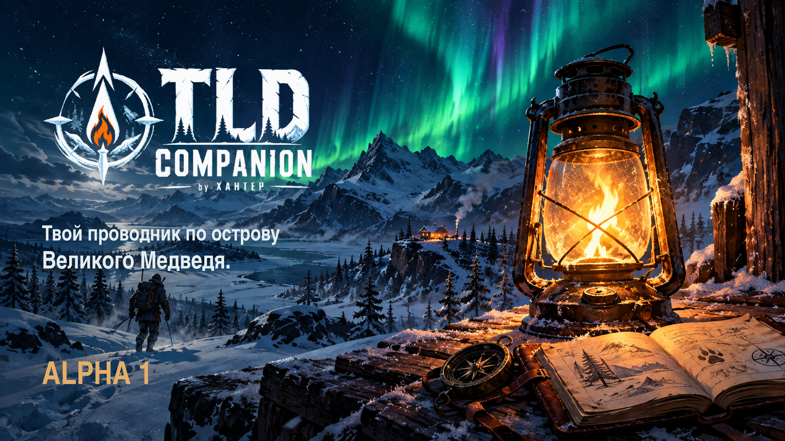
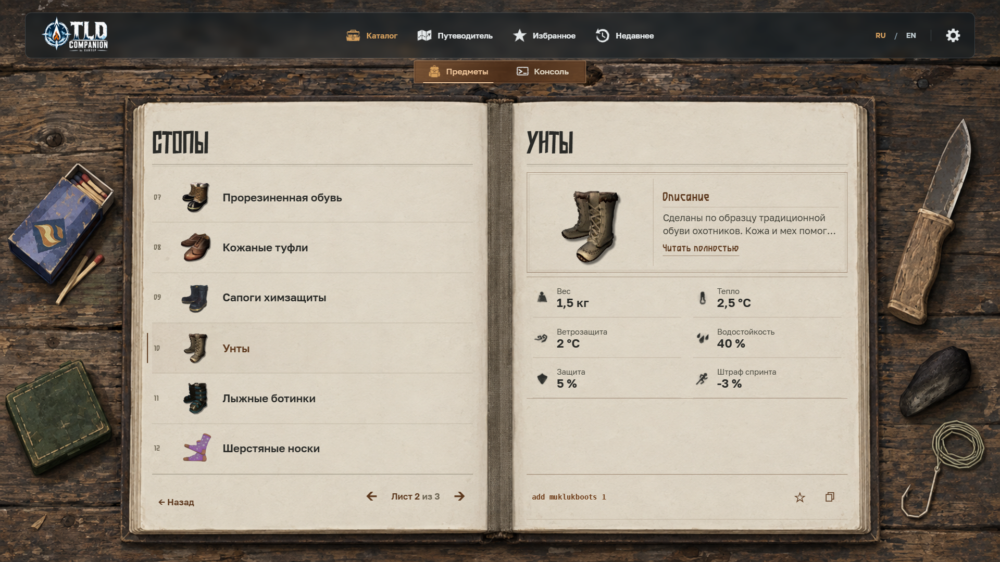
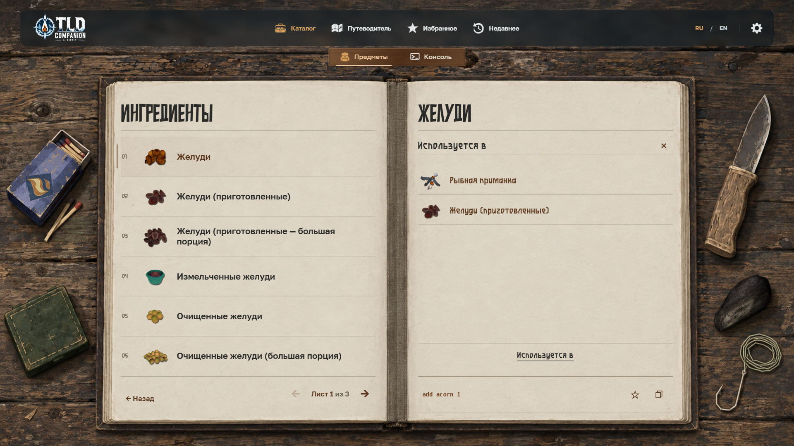

# TLD Companion — Alpha 1

RU/EN offline companion for **The Long Dark Survival, v2.55 / build 181032 S**. By **XAHTEP**.

[Открыть / Open website](https://xahtep-bna.github.io/TLD-Companion/) · [Скачать / Download Alpha 1](https://github.com/XAHTEP-BNA/TLD-Companion/releases/tag/alpha-1) · [Обратная связь / Feedback](https://github.com/XAHTEP-BNA/TLD-Companion/issues)

## Русский

Неофициальный фанатский справочник для Windows PC: 506 идентичностей предметов, 491 строка каталога, 7 категорий и 41 подкатегория. Варианты семейства переключаются внутри записи. Поиск работает на русском и английском; доступны характеристики, связанные предметы, избранное и история.

Консоль содержит 59 сущностей и 105 исходных форм команд. Неподтверждённые действия сохраняют блокировки. Готовую команду можно скопировать; Companion не выполняет её в игре. Пункт **«Установка консоли»** открывает руководство в Passport.

**Запуск:** откройте сайт либо скачайте единственный `TLD-Companion-Alpha-1.zip`, полностью распакуйте его и откройте `index.html` в актуальном Chrome или Edge. Сервер, установка приложения и интернет для локального просмотра не нужны. Не запускайте HTML прямо из окна ZIP. Сайт и архив используют одинаковый комплект runtime-файлов.

**Совместимость:** данные рассчитаны на Survival 2.55, build 181032 S. Mobile и Wintermute не входят в целевой контракт. Для выполнения команд в самой игре нужны отдельно устанавливаемые моды; ссылка на актуальную документацию приведена в руководстве. Совместимость всей комбинации модов и gameplay-эффекты не проверялись игровыми runtime-тестами.

**Ограничения Alpha:** отдельные сведения и местонахождения остаются неизвестными; для них не создавались вымышленные значения. Для одной записки отсутствует исходное изображение. Некоторые действия консоли недоступны. Дробные аргументы и текстовые токены сохраняют документированные ограничения. Избранное, история и настройки сохраняются локально в браузере; сайт и `file://` имеют раздельное хранилище. Буфер обмена зависит от разрешений браузера; строку команды можно выделить вручную.

## English

An unofficial Windows PC reference with 506 item identities, 491 catalog rows, 7 categories and 41 subcategories. Family variants share a catalog entry. Includes bilingual search, applicable stats, related entries, favorites and recent history.

The Console has 59 entities and 105 source command forms. Unsupported actions remain gated. Copy transfers the prepared command; Companion never runs it in the game. **Console Setup** opens the installation guide in Passport.

**Run:** open the website, or download the single `TLD-Companion-Alpha-1.zip`, extract the entire archive and open `index.html` in current Chrome or Edge. The offline app needs no server, installation or network access. Do not open HTML inside the ZIP viewer. Website and archive use the same runtime files.

**Compatibility:** data targets Survival v2.55 / build 181032 S. Mobile and Wintermute are outside the target scope. Executing commands in the game requires separately installed mods; consult the linked documentation. The complete mod combination and gameplay effects have not been runtime-tested.

**Alpha limitations:** some content/acquisition details remain unknown; no substitute facts are invented. One note lacks source artwork. Certain Console actions remain unavailable; documented float/text restrictions remain. Favorites, history and preferences stay in browser-local storage; website and `file://` storage are separate. Clipboard access depends on browser permissions; command text remains manually selectable.

## Screenshots

Previously prepared feature screenshots. The final Alpha 1 adds Console Setup to the upper navigation; these captures show the unchanged feature content.

## Notices

Unofficial fan project, not affiliated with or endorsed by Hinterland Studio. The Long Dark and original game artwork/text belong to their respective rights holders. Third-party font and code notices are included in `docs/licenses/` and the downloadable runtime. This repository contains the public static runtime; private development sources, extracted game-source archives and research material are not published.

Report issues through [GitHub Issues](https://github.com/XAHTEP-BNA/TLD-Companion/issues). Please include browser, language, window size and steps to reproduce; do not attach private saves or credentials.
