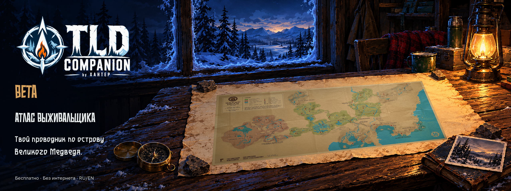
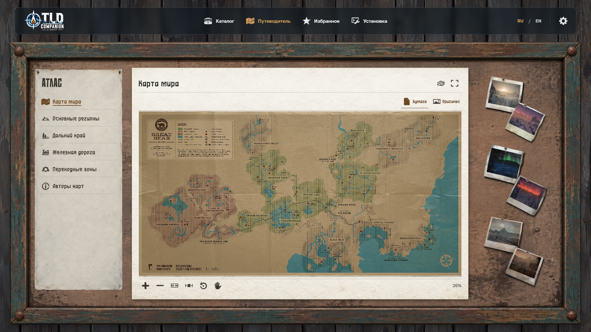
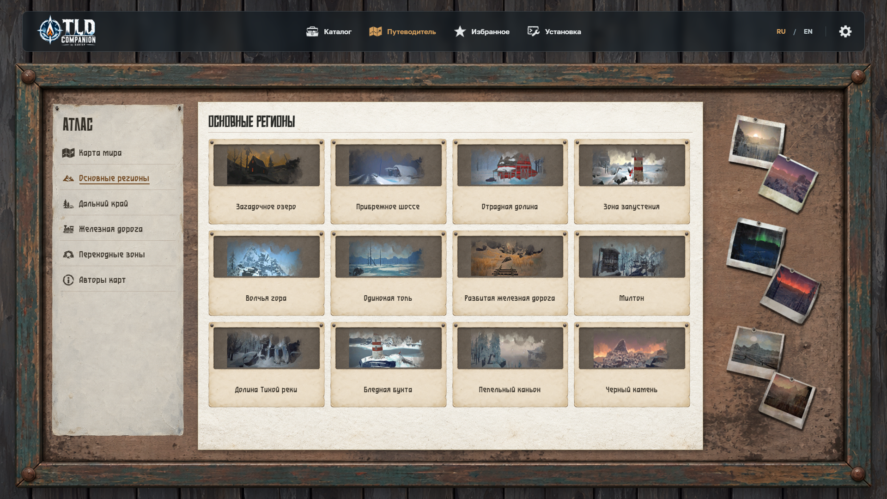
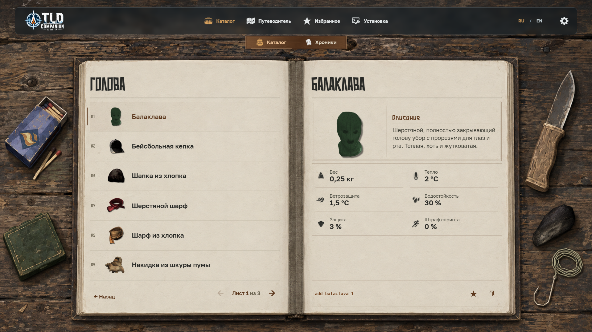
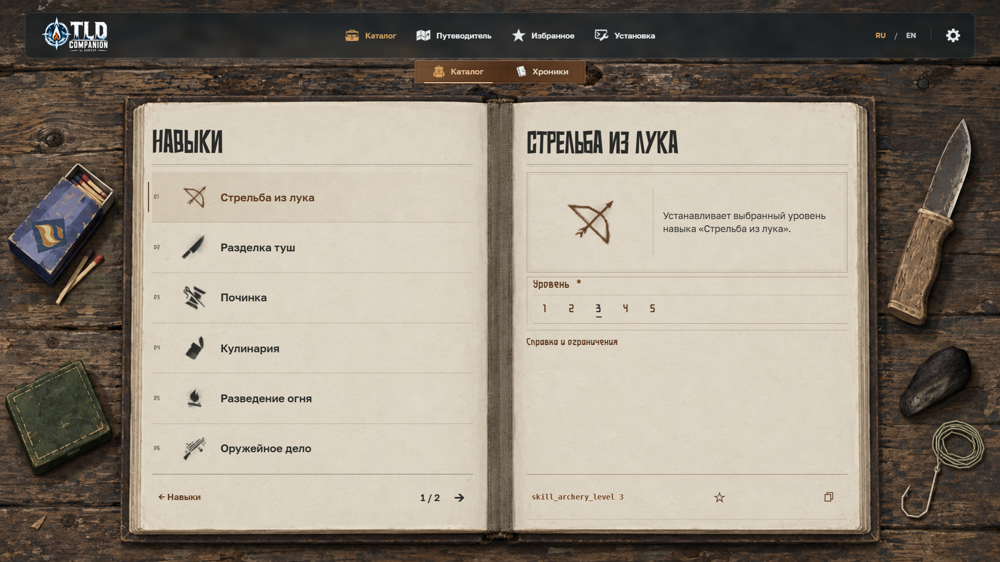
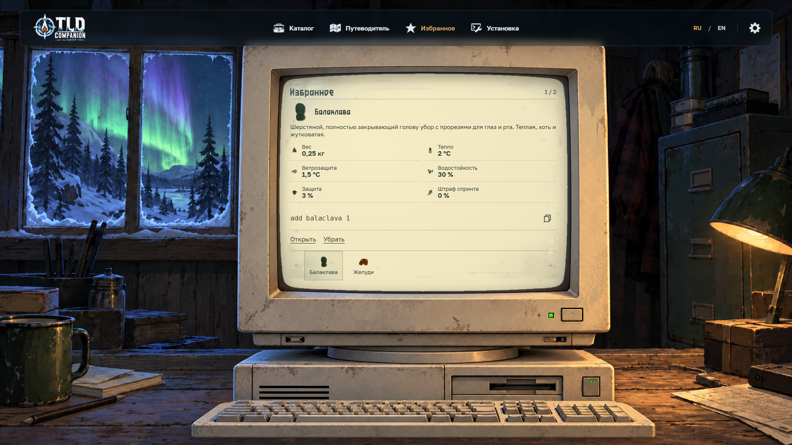
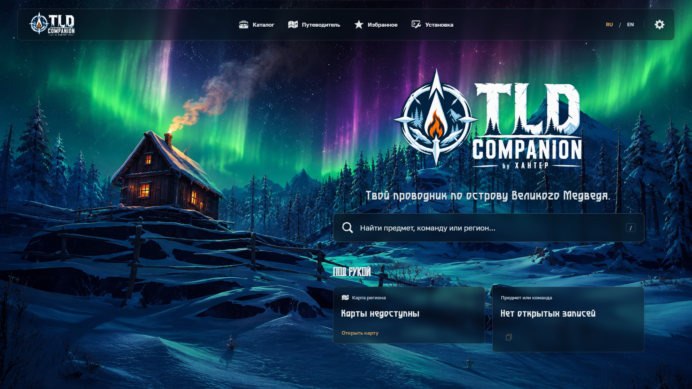

[**Русский**](README.md) · [English](README_EN.md)

# TLD Companion — Beta

**Твой проводник по острову Великого Медведя.** Бесплатный офлайн-помощник для The Long Dark: Survival Mode на Windows PC. Каталог, карты и нужные команды — рядом с игрой, на RU и EN.

[**Скачать Beta для Windows PC**](https://github.com/XAHTEP-BNA/TLD-Companion/releases/latest/download/TLD-Companion-Beta.zip) · [**Открыть онлайн**](https://xahtep-bna.github.io/TLD-Companion/) · [Что изменилось](PATCH_NOTES_RU.md)

## Атлас выживальщика

Исследуй карту мира, выбирай регионы на доске атласа, приближай нужные места и раскрывай карту на весь экран. Варианты обычной сложности и «Незваного гостя» доступны там, где они есть в подборке. Переключай «Бумага / Оригинал» и возвращайся к последней открытой карте с Главной.

## Предметы, консоль и Избранное

- **Каталог:** 523 предмета, оригинальные изображения, описания и применимые характеристики в журнале выживальщика.
- **Поиск RU/EN:** находи предмет по русскому или английскому названию и открывай его карточку.
- **Консоль:** 59 разделов команд; параметры доступных действий и готовая строка для копирования. Инструкция установки — в отдельном пункте навигации.
- **Избранное:** держи нужные предметы и команды под рукой на Aurora Terminal.
- **Главная:** две независимые истории недавно просмотренных предметов/команд и карт.

## Как запустить

1. [Скачай ZIP Beta](https://github.com/XAHTEP-BNA/TLD-Companion/releases/latest/download/TLD-Companion-Beta.zip).
2. Полностью распакуй его в отдельную папку.
3. Открой **index.html** в **Chrome или Edge**. Интернет не требуется.

Можно пользоваться [онлайн-версией](https://xahtep-bna.github.io/TLD-Companion/) без скачивания. Избранное и история сохраняются в текущем браузере; данные разных браузеров и адресов не объединяются автоматически.

## Перед использованием

Companion не меняет игру и не выполняет команды за тебя. Консоль устанавливается отдельно. Некоторые команды недоступны; карты Железной дороги пока не включены. Подборка содержит 23 карточки карт, включая мир, и 42 уникальных исходных листа; отдельные карточки могут открывать общий лист. Полное покрытие 2.58 не заявляется. Это Beta: сообщай о найденных проблемах через [Issues](https://github.com/XAHTEP-BNA/TLD-Companion/issues).

## Авторы и благодарности

Companion — **XAHTEP**. Карты: **[HokuOwl](https://steamcommunity.com/sharedfiles/filedetails/?id=3255435617)** и **[Krueger](https://steamcommunity.com/sharedfiles/filedetails/?id=2899955301)**; подписи авторов сохранены, ссылки доступны и в справке атласа. The Long Dark и игровые материалы принадлежат **Hinterland Studio**. Это неофициальный фанатский проект, не связанный с Hinterland. Уведомления о шрифтах и библиотеках находятся в `licenses/` внутри ZIP.

[Актуальный релиз и контрольные суммы](https://github.com/XAHTEP-BNA/TLD-Companion/releases/latest) · [Изменения на английском](PATCH_NOTES_EN.md)
