
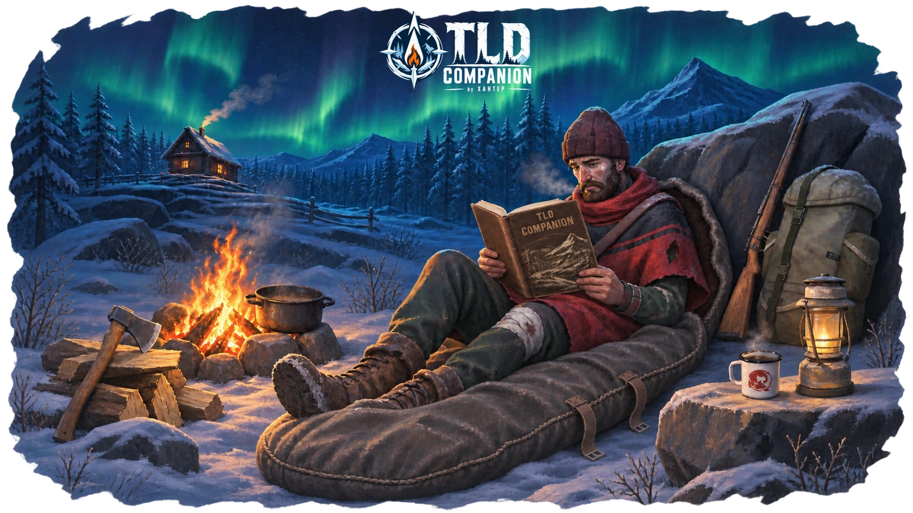

<h1 align="center">TLD Companion by XAHTEP</h1>

<em>Твой проводник по острову Великого Медведя.</em>

Справочник для The Long Dark: Survival Mode. Найдите нужный предмет, посмотрите карту, проверьте рецепт или подготовьте консольную команду во время игры. Companion работает в браузере и доступен для использования без интернета.

<a href="https://github.com/XAHTEP-BNA/TLD-Companion/releases/latest/download/TLD-Companion.zip">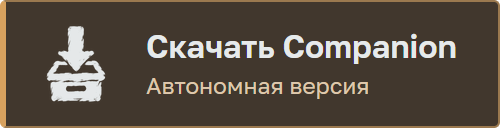</a>

 /

## Обновление 1.0.1

Дополнительные разделы карточек получили более крупный текст и внутреннюю прокрутку. Уточнены эффекты и побочные эффекты, оформление рецептов и переходы к связанным предметам. Возврат сохраняет открытый раздел и положение прокрутки.

На телефоне используется тот же интерфейс в горизонтальной ориентации с доступным увеличением. Вертикальный экран показывает локализованную подсказку поворота. Обе карты Зоны запустения обновлены исходниками HokuOwl 1.04; обозначение Game 2.58 и авторство сохранены.

## Разделы

<a href="#обустройство">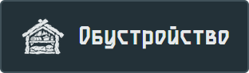</a>

<a href="#путеводитель">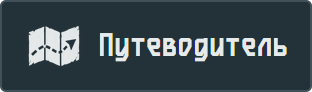</a>

## Главная

Главная помогает быстро вернуться к игре с нужной информацией. Здесь находятся поиск и два независимых раскрывающихся блока «Под рукой»: недавно просмотренные карты и записи. Можно оставить открытым нужный список, а второй свернуть.

### Поиск

Введите русское или английское название, его часть или известную команду. Из результатов можно открыть карточку, а доступную команду скопировать сразу, без перехода на другую страницу. Это удобно, когда вы уже знаете, что ищете.

Посмотреть поиск в действии

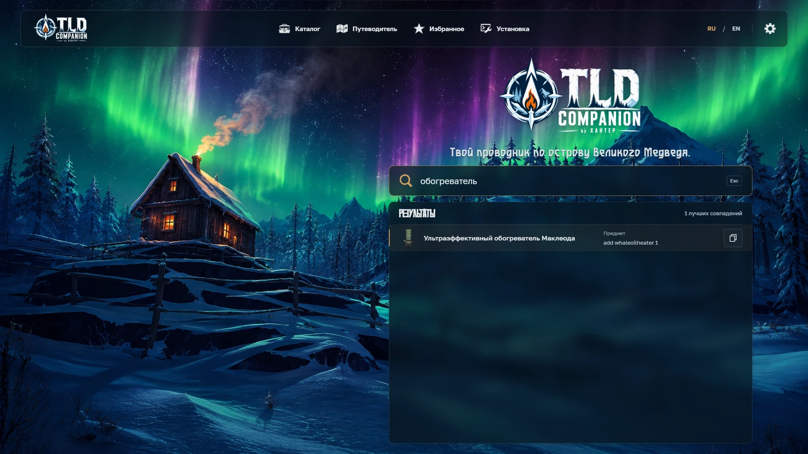

## Каталог предметов

Каталог оформлен как раскрытый журнал. Выберите категорию и рубрику, затем листайте список предметов. При открытии карточки соседние записи остаются слева, поэтому между ними легко переключаться.

Справа находятся оригинальное изображение, описание и характеристики: например, вес, защита от холода или свойства инструмента. У связанных разновидностей есть переключатель внутри общей карточки. Дополнительные страницы открывают сведения о применении и связанных предметах. Записки и другие текстовые находки можно читать с перелистыванием.

Звёздочка сохраняет запись в Избранное. Если доступна консольная команда, она показана внизу карточки рядом с кнопкой копирования.

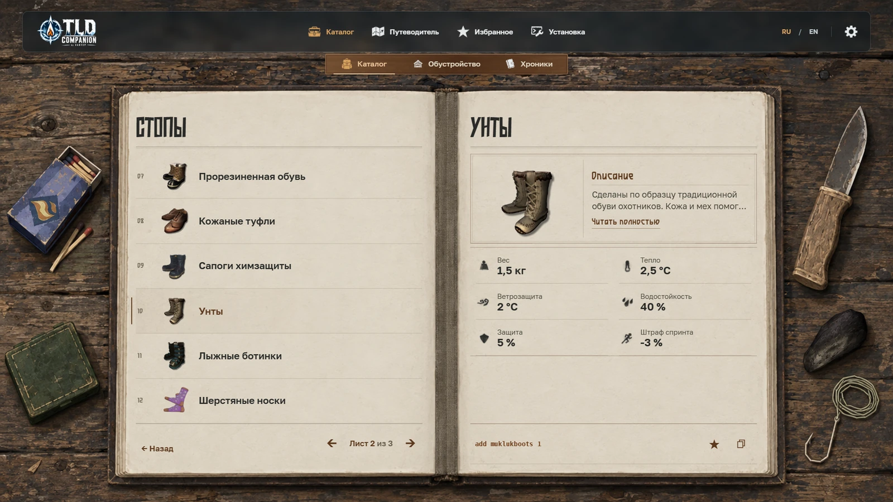

### Хроники

Пункт «Хроники» находится внутри Каталога и пока показывает «В разработке». Записки и письма, уже доступные в справочнике, читаются в карточках соответствующих предметов.

## Обустройство

В Обустройстве собраны мебель, светильники, бытовые вещи и оборудование для убежища. Категории помогают подобрать предмет под нужную часть комнаты. Варианты одного семейства переключаются внутри карточки, рядом видны изображение и описание выбранного объекта.

Для изготавливаемых предметов доступны рецепты с количеством материалов, инструментами, временем и местом изготовления. Нажмите на материал или инструмент, чтобы открыть его карточку в Каталоге. Кнопка возврата приведёт к тому же рецепту, чтобы вы могли продолжить проверку списка.

Для создания объектов через команды нужна совместимая установка SafehouseCustomizationPlus. Ссылка «Как использовать команды мебели?» ведёт к инструкции в самом Companion.

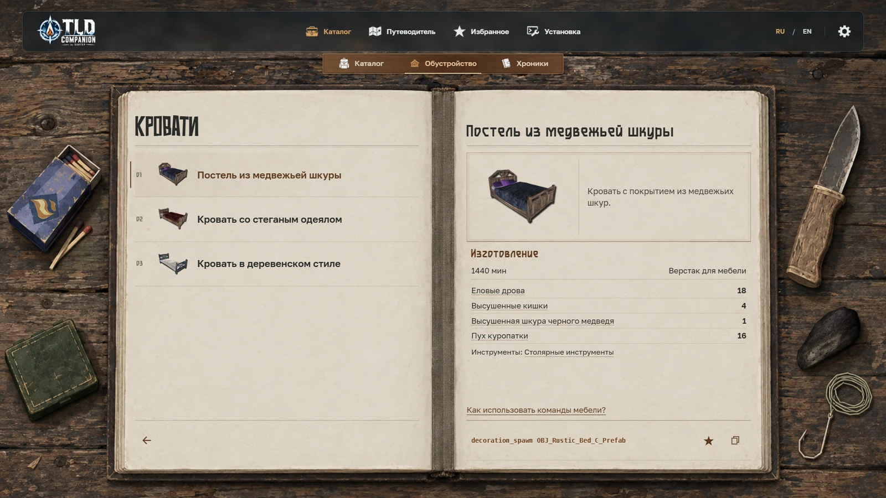

## Консольные команды

Раздел Консоли помогает подготовить команду для навыков, животных, персонажа, недугов, мира или карты. Выберите запись и нужное действие, заполните параметры и проверьте готовую строку. Для единственного действия дополнительный выбор не нужен.

Например, в карточке навыка можно выбрать уровень и скопировать готовую команду. Обязательные поля отмечены; неподходящий ввод не позволяет скопировать ошибочную строку. Недоступные действия не предлагают активную кнопку Copy.

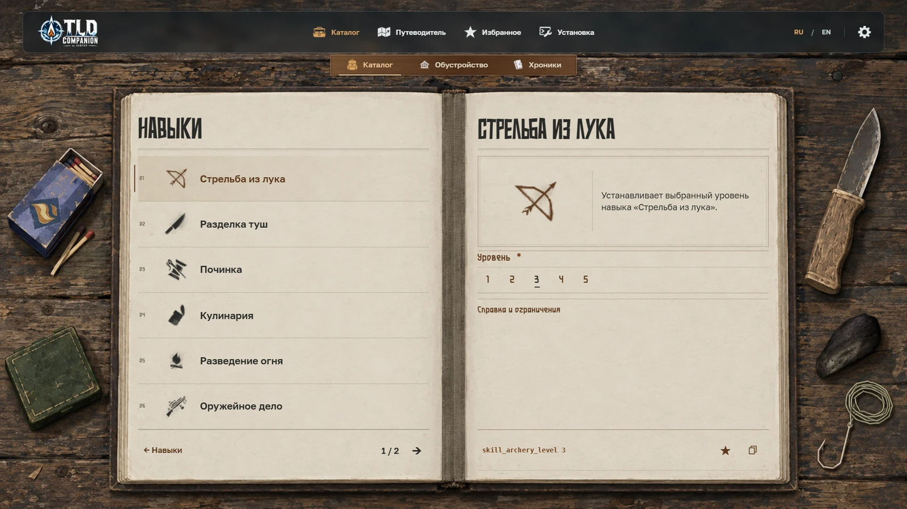

## Путеводитель

Путеводитель открывает карту мира, регионы и переходные зоны. Выберите район по превью, затем перемещайте и увеличивайте карту, чтобы рассмотреть маршрут. Есть подгонка под рабочую область, исходный масштаб и режим сосредоточенного просмотра.

Для некоторых регионов можно переключиться между обычной картой и картой для «Незваного гостя». Интерактивные отметки на карте мира помогают перейти к нужному региону. Данные об авторах и ссылки на их руководства доступны в справке Путеводителя. Карты Железной дороги пока не добавлены.

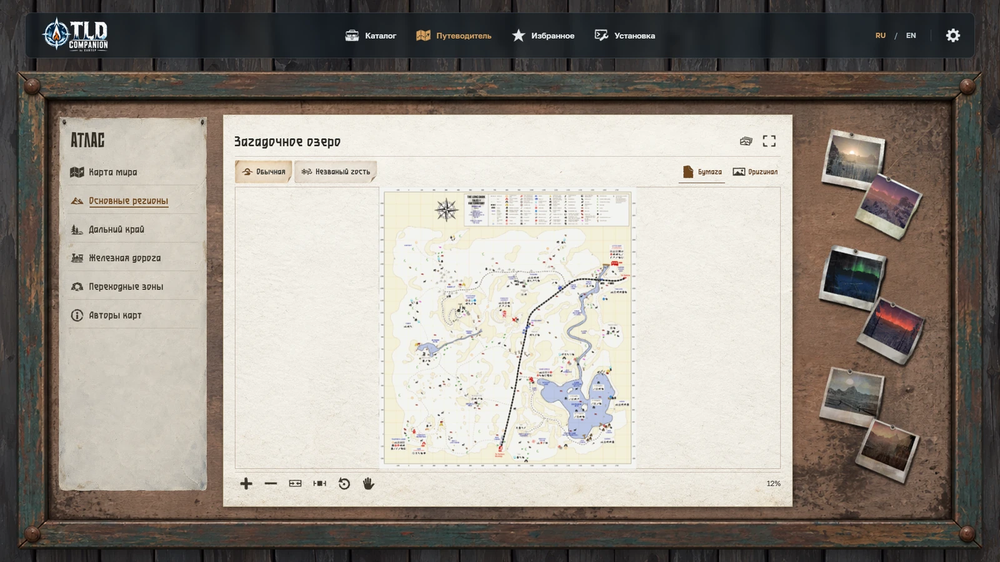

## Избранное

Сохраняйте предметы, команды и объекты обустройства звёздочкой. Избранное оформлено как экран старого терминала: выберите запись в нижнем ряду, откройте полную карточку или скопируйте доступную команду прямо здесь.

У сохранённых команд остаются выбранное действие и введённые значения. Подготовленную команду можно использовать снова, без повторного заполнения полей. Ненужную запись можно убрать из списка.

### Недавнее

Недавнее находится на Главной в блоках «Под рукой». Карты и записи хранятся в отдельных списках: после просмотра маршрута можно вернуться к предмету или команде, не разыскивая их заново.

## Настройки и язык

Кнопки RU / EN переключают язык интерфейса. В Настройках также можно включить дополнительные английские названия предметов, если удобнее сопоставлять их с англоязычными руководствами. Настройки открываются кнопкой шестерёнки в верхней панели и сохраняются на вашем устройстве.

Посмотреть настройки

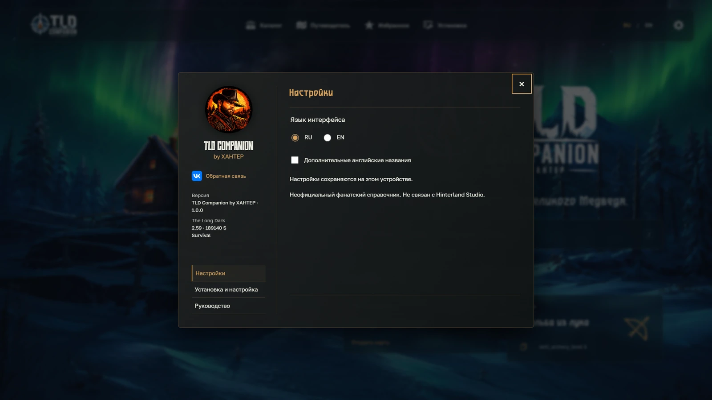

## Установка консоли

Пункт «Установка» в основной навигации открывает инструкции для игровой консоли и обустройства убежища. Выберите нужную тему и следуйте страницам руководства. В нём есть ссылки на загрузку совместимых модов и их зависимостей.

Сам Companion устанавливать в папку игры не нужно. Моды требуются только для использования соответствующих команд в The Long Dark.

Посмотреть инструкцию

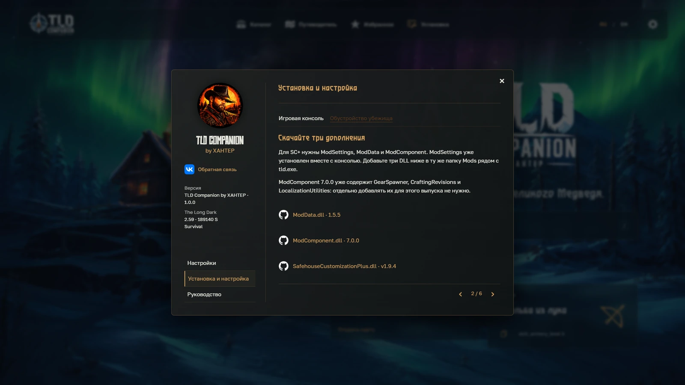

## Запуск без интернета

1. [Скачайте TLD-Companion.zip](https://github.com/XAHTEP-BNA/TLD-Companion/releases/latest/download/TLD-Companion.zip).
2. Полностью распакуйте архив в постоянную папку.
3. Откройте `TLD-Companion/index.html` в Google Chrome или Microsoft Edge.

Карты, изображения и шрифты уже находятся в архиве. Для просмотра справочника интернет не нужен; внешние ссылки открываются по вашему действию и требуют подключения. Если скачивание не требуется, используйте [веб-версию](https://xahtep-bna.github.io/TLD-Companion/). Companion рассчитан на Windows PC.

## Важные сведения

- Companion готовит и копирует команды, но не выполняет их в игре и не устанавливает моды.
- Для консольных функций нужны совместимые моды. Совместимость зависит от версии The Long Dark.
- Настройки, Избранное и история хранятся локально. Они не синхронизируются автоматически между браузерами, сайтом и скачанной копией. Для обновления офлайн-версии сохраняйте прежнее расположение папки.
- Очистка данных браузера и приватный режим могут удалить сохранённое. Доступность игровых предметов зависит от режима, дополнений и вашего сохранения.

## Авторство и обратная связь

Проект создан **XAHTEP**. Если нашли ошибку, [создайте Issue](https://github.com/XAHTEP-BNA/TLD-Companion/issues) или [напишите автору](https://vk.ru/blumenstein). Укажите название предмета или раздела, язык, браузер и действия, после которых возникла проблема.

Карты подготовили **HokuOwl** ([Steam](https://steamcommunity.com/profiles/76561198212232496), [руководство](https://steamcommunity.com/sharedfiles/filedetails/?id=3255435617)) и **Krueger** ([Steam](https://steamcommunity.com/profiles/76561198054890338), [руководство](https://steamcommunity.com/sharedfiles/filedetails/?id=2899955301)). Благодарим [Elektronixx](https://github.com/Elektronixx/TLD-Interactive-Map) за источник сведений об авторах карт.

Благодарности авторам [Developer Console](https://github.com/DigitalzombieTLD/TLD-Developer-Console), [SafehouseCustomizationPlus](https://github.com/HAHAYOUDEAD/SafehouseCustomizationPlus), используемых модов и зависимостей, а также React и шрифтов Golos Text, NeverSmile, Nozhik и DejaVu. [Уведомления об авторстве и лицензии](docs/licenses/) сохранены в приложении и дистрибутиве.

TLD Companion является неофициальным фанатским справочником и не связан с Hinterland Studio. The Long Dark, оригинальные игровые изображения и тексты принадлежат [Hinterland Studio](https://www.thelongdark.com/) и другим правообладателям.
