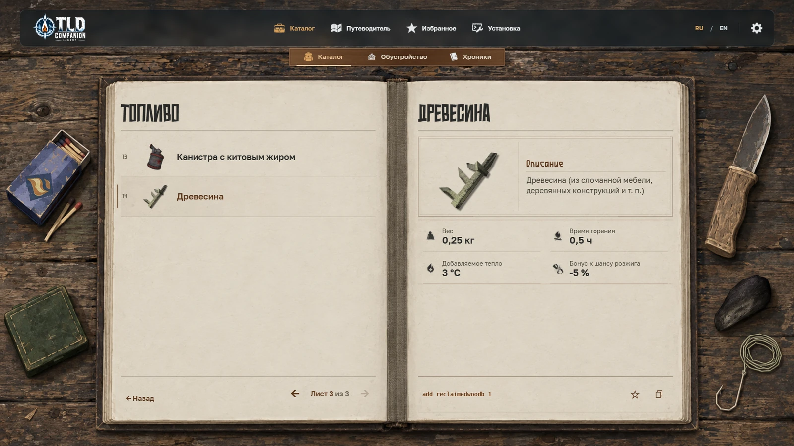

# TLD Companion by XAHTEP

**Бесплатный RU/EN-справочник для режима выживания The Long Dark. Версия 1.0.0.**

Найдите нужный предмет, проверьте характеристики, откройте карту или подготовьте консольную команду. Каталог оформлен как раскрытый журнал; карты собраны в отдельном атласе, а часто используемые записи можно сохранить в Избранное. Companion работает в браузере, в том числе без интернета после скачивания.

[Открыть веб-версию](https://xahtep-bna.github.io/TLD-Companion/) · [Скачать из последнего релиза](https://github.com/XAHTEP-BNA/TLD-Companion/releases/latest/download/TLD-Companion.zip) · [English](README_EN.md)

## Начните с поиска

На Главной можно искать по русским и английским названиям, известным синонимам и точной команде. Открывайте найденную запись или копируйте доступную команду. Два независимых блока «Под рукой» возвращают к недавно открытым картам и записям; ненужный список можно свернуть.

## Предметы — от оглавления к характеристикам

В каталоге 527 предметных записей, распределённых по семи категориям и 41 подкатегории. Выберите рубрику, перелистайте индекс и откройте предмет: соседние записи остаются на левой странице, подробности — на правой. У связанных разновидностей есть переключатель внутри карточки.

Карточки показывают оригинальное изображение, описание и подтверждённые характеристики. Дополнительные страницы содержат доступные сведения о применении и связях. Записки и восковые валики можно читать с перелистыванием текста. Команда отображается отдельно и копируется только там, где она подтверждена.

Все 134 ссылки в 44 рецептах ведут к существующим материалам и инструментам. Включена древесина из разобранной мебели; переход из рецепта сохраняет контекст для возврата.

Канистра с китовым жиром, обогреватель Маклеода и тормозная колодка включены с описаниями и изображениями. Неподтверждённые параметры для них не показаны. Наличие записи не означает доступность предмета в любом сохранении, регионе или наборе дополнений.

## Обустройство — вещи для вашего убежища

849 карточек представляют 862 объекта: мебель, бытовые предметы, светильники, оборудование и другие элементы обустройства. Десять категорий помогают найти нужную вещь; разновидности сгруппированы в 13 семействах. Для 44 изготавливаемых предметов доступны рецепты с материалами, количеством, инструментами и временем изготовления.

Нажмите подчёркнутый материал рецепта, чтобы открыть существующую карточку в Каталоге. Кнопка «Назад» вернёт к тому же рецепту. Если точная связь пока не установлена, название остаётся обычным текстом.

Создание объектов обустройства через команды требует совместимой установки SafehouseCustomizationPlus. Порядок установки и ограничения приведены в разделе «Установка».

## Консоль — подготовьте команду без ручной сборки

59 записей объединяют команды навыков, животных, персонажа, недугов, мира и карты. Выберите действие, заполните нужные поля и проверьте готовую строку перед копированием. Где действие единственное, лишнего выбора нет. Неполные или недопустимые значения не дают скопировать команду; неподтверждённые действия остаются недоступными.

Companion не выполняет команды в игре и не устанавливает моды. Для использования нужна совместимая Developer Console. Инструкции и ссылки находятся в пункте основной навигации «Установка». Совместимость модов зависит от версии игры; не все команды и эффекты проверены запуском в игре.

## Путеводитель — рассмотрите карту в деталях

Откройте карту мира, выберите регион или переходную зону. Можно двигать и увеличивать карту, подогнать её под рабочую область, открыть исходный размер и перейти в режим сосредоточенного просмотра. Для некоторых регионов доступны отдельные карты обычного режима и «Незваного гостя».

В атласе 23 записи: карта мира, 12 основных регионов, четыре региона Дальнего края и шесть переходных зон. Север и юг Перевала Смотрителя имеют отдельные карточки и открывают общий исходный лист. Карты Железной дороги пока не добавлены; этот раздел не подменён чужими картами.

## Избранное — всё необходимое под рукой

Сохраняйте предметы, команды и объекты обустройства звёздочкой в карточке. Переключайтесь между сохранёнными записями, открывайте полную карточку или используйте доступную команду прямо из Избранного. Для команд сохраняются выбранное действие и введённые значения.

## Установка и офлайн-запуск

1. Откройте [последний релиз](https://github.com/XAHTEP-BNA/TLD-Companion/releases/latest/download/TLD-Companion.zip) и скачайте `TLD-Companion.zip`.
2. Полностью распакуйте архив в постоянную папку.
3. Откройте `TLD-Companion/index.html` в Google Chrome или Microsoft Edge.

Сервер, Node.js и установка Companion не нужны. Изображения, карты и шрифты входят в архив. Внешние ссылки требуют интернета и открываются по вашему действию. Companion предназначен для Windows PC; ориентир — 1920×1080, также проверен при 1366×768. В небольшом окне текст физически мельче.

Язык переключается кнопками RU / EN. Настройки, Избранное и история хранятся локально в браузере. При обновлении веб-версии используйте тот же браузер, профиль и адрес. Данные не синхронизируются между браузерами и не переносятся автоматически между сайтом и офлайн-копией. Для офлайн-версии сохраняйте прежний путь папки: поведение хранилища `file://` зависит от браузера. Очистка данных сайта или приватный режим могут удалить сохранённое.

## Обратная связь и авторство

Нашли ошибку? [Создайте Issue](https://github.com/XAHTEP-BNA/TLD-Companion/issues), укажите версию Companion, язык, браузер, размер окна и шаги воспроизведения. При ошибке в данных добавьте название предмета или команды.

Разработчик проекта — **XAHTEP**. TLD Companion — неофициальный фанатский справочник, не связанный с Hinterland Studio и не одобренный ею. The Long Dark, оригинальные игровые изображения и тексты принадлежат их правообладателям.

Карты: **HokuOwl** ([Steam](https://steamcommunity.com/profiles/76561198212232496), [руководство](https://steamcommunity.com/sharedfiles/filedetails/?id=3255435617)) и **Krueger** ([Steam](https://steamcommunity.com/profiles/76561198054890338), [руководство](https://steamcommunity.com/sharedfiles/filedetails/?id=2899955301)). Благодарим Elektronixx за источник сведений об авторах. В приложении есть отдельная справка с этими ссылками.

Благодарности авторам Developer Console и SafehouseCustomizationPlus. Используются React, Golos Text, NeverSmile, Nozhik и DejaVu; уведомления об авторстве и лицензии включены в папку `licenses` дистрибутива. Перечисление материалов не означает передачу прав на них.
