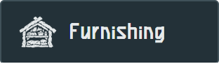
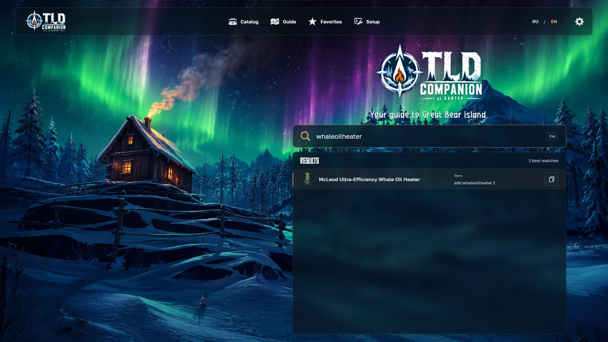
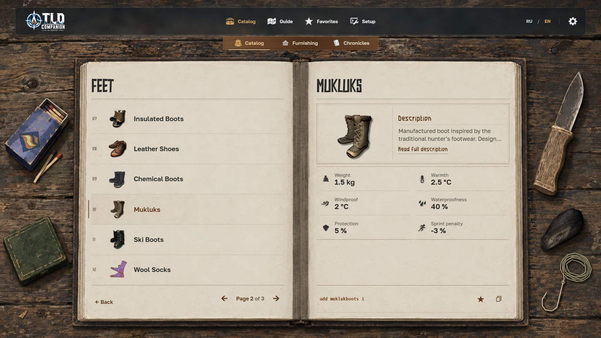
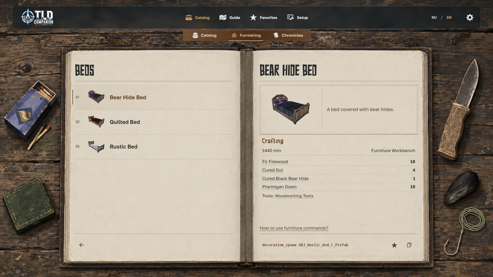
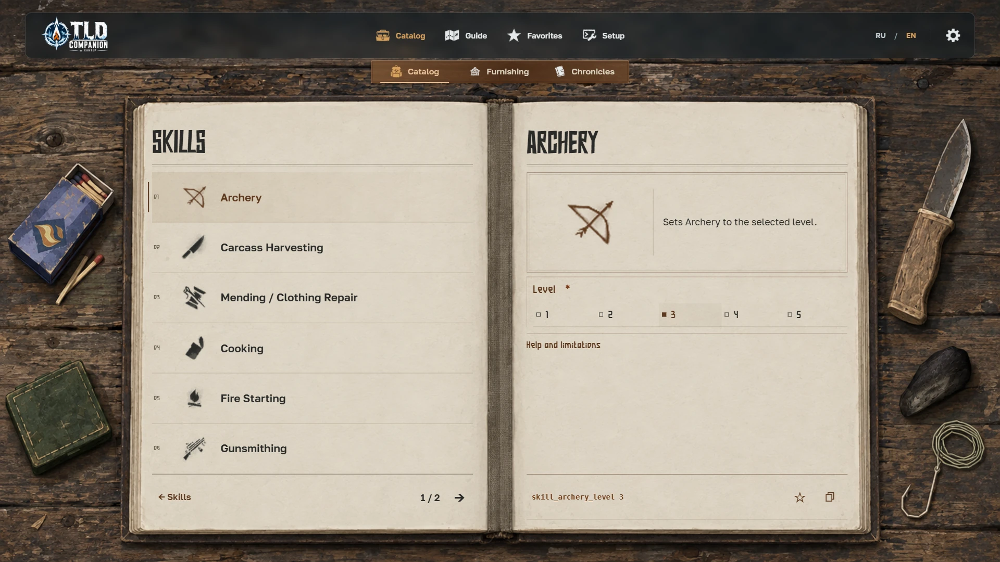
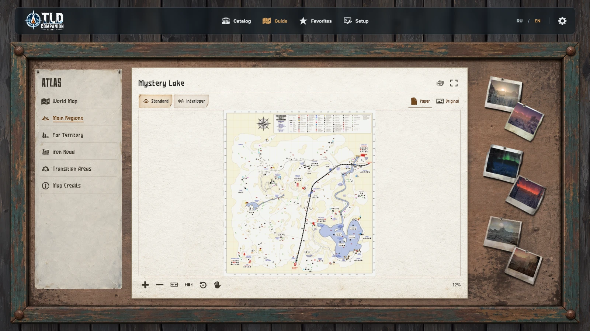
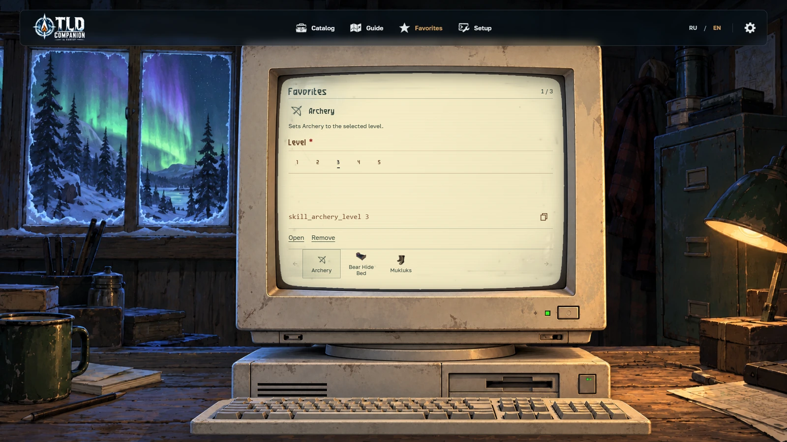
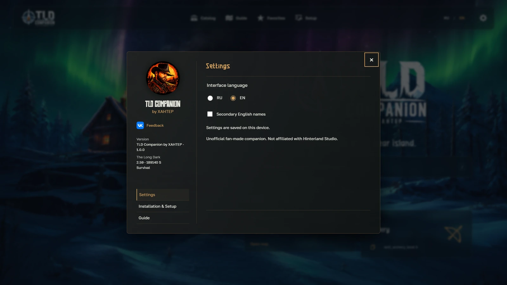
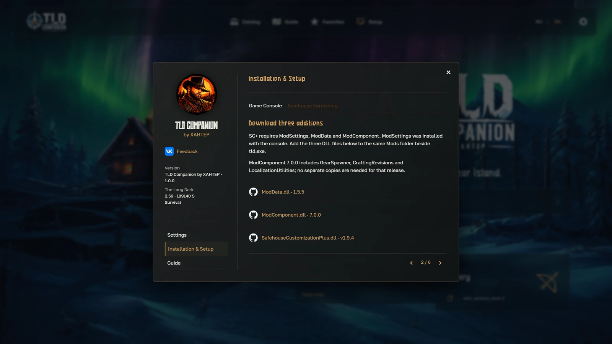

<h1 align="center">TLD Companion by XAHTEP</h1>

<em>Your guide to Great Bear Island.</em>

A reference companion for The Long Dark: Survival Mode. Look up an item, check a map, plan a crafting project or prepare a console command while you play. Use Companion in your browser or download it for offline use.

 /

## Version 1.0.1

Supplemental item sections now use larger text and internal scrolling. Effects, side effects, recipes and related-item links are more consistent. Returning from a linked entry restores the section and scroll position.

Phones use the same interface in landscape with browser zoom. Portrait displays a localized rotation screen. Both Desolation Point maps use the HokuOwl 1.04 originals; their Game 2.58 source label and credits are preserved.

## Explore Companion

## Home

Home is a quick way to find an answer and get back to playing. It brings together Search and two separate collapsible lists of recent maps and entries. Keep the list you need open and fold away the other.

### Search

Search by a Russian or English name, part of a name or a known command. Open an entry from the results or copy an available command directly from the list. It is a useful shortcut when you already know what you are looking for.

See Search in action

## Item catalog

The item catalog takes the form of an open journal. Choose a category and section, then turn through the item index. Opening an entry keeps neighboring items on the left page so you can switch between them without returning to the index.

The right page shows original artwork, a description and relevant facts, such as weight, warmth or tool properties. Related variants share a card with a variant selector. Additional pages contain available usage information and related items. Notes and other written finds can be read with page controls.

Use the star to save an entry to Favorites. Where a console command is available, it appears at the bottom of the card beside Copy.

### Chronicles

Chronicles is an entry within the Catalog and currently shows “In development.” Notes and letters already included in Companion can be read on their item cards.

## Furnishing

Browse furniture, lighting, household objects and equipment for your safehouse. Categories help you find a piece for a particular part of the room. Related variants share a card, with artwork and a description for the selected object.

Craftable entries include material quantities, tools, crafting time and the required workstation. Select a material or tool to open its item card. The return control takes you back to the same recipe so you can continue checking what you need.

Spawning furnishing objects requires a compatible SafehouseCustomizationPlus setup. The “How to use furniture commands?” link opens the instructions inside Companion.

## Console commands

Prepare commands for skills, animals, character status, afflictions, the world and maps. Choose an entry and an action, fill in its parameters and check the finished command. Entries with a single action skip the extra selection.

For example, a skill entry lets you choose a level and copy the command. Required fields are marked, and invalid input prevents copying an incomplete or incorrect line. Unavailable actions do not offer an active Copy button.

## Guide

Open the world map, a region or a transition zone. Choose an area from its preview, then pan and zoom to inspect a route. You can fit the map to the workspace, view its original scale or use focused viewing mode.

Some regions include separate regular and Interloper maps. Interactive marks on the world map open the corresponding region. The Guide credits page lists map authors and links to their guides. Iron Road maps have not yet been added.

## Favorites

Save items, commands and furnishing objects using the star. Favorites appears on an old terminal: choose an entry along the bottom, open its full card or copy an available command without leaving this screen.

Saved commands retain their selected action and entered values, ready to use again without filling in the same fields. Remove entries when you no longer need them.

### Recent

Recent maps and entries appear in separate lists on Home. After checking a route, you can return to an item or command without searching for it again.

## Settings and language

Use RU / EN to change the interface language. Settings also lets you show secondary English item names, which can help when following English-language guides. Open Settings with the gear in the top bar. Your choices are saved on your device.

See Settings

## Console setup

Setup in the main navigation contains instructions for the game console and safehouse furnishing tools. Choose a topic and follow the pages, including links to compatible mods and their dependencies.

Companion itself does not need to be installed in the game folder. Mods are only needed to use the corresponding commands in The Long Dark.

See the setup guide

## Offline use

1. [Download TLD-Companion.zip](https://github.com/XAHTEP-BNA/TLD-Companion/releases/latest/download/TLD-Companion.zip).
2. Extract the entire archive to a permanent folder.
3. Open `TLD-Companion/index.html` in Google Chrome or Microsoft Edge.

Maps, artwork and fonts are included, so browsing Companion does not require internet access. External links open when you choose them and need a connection. You can also use the [web version](https://xahtep-bna.github.io/TLD-Companion/) without downloading. Companion is designed for Windows PC.

## Important information

- Companion prepares and copies commands. It does not execute them in the game or install mods.
- Console functions require compatible mods. Compatibility depends on your version of The Long Dark.
- Settings, Favorites and history are stored locally. They do not sync automatically between browsers, the website and a downloaded copy. Keep the same folder location when updating the offline version.
- Clearing browser data or using private browsing can remove saved information. In-game item availability depends on the mode, expansions and your save.

## Credits and feedback

Created by **XAHTEP**. To report a problem, [open an Issue](https://github.com/XAHTEP-BNA/TLD-Companion/issues) or [contact the author](https://vk.ru/blumenstein). Include the item or section, language, browser and steps that led to the problem.

Maps by **HokuOwl** ([Steam](https://steamcommunity.com/profiles/76561198212232496), [guide](https://steamcommunity.com/sharedfiles/filedetails/?id=3255435617)) and **Krueger** ([Steam](https://steamcommunity.com/profiles/76561198054890338), [guide](https://steamcommunity.com/sharedfiles/filedetails/?id=2899955301)). Thanks to [Elektronixx](https://github.com/Elektronixx/TLD-Interactive-Map) for the map credits source.

Thanks to the authors of [Developer Console](https://github.com/DigitalzombieTLD/TLD-Developer-Console), [SafehouseCustomizationPlus](https://github.com/HAHAYOUDEAD/SafehouseCustomizationPlus) and their mod dependencies, as well as React and the Golos Text, NeverSmile, Nozhik and DejaVu typefaces. [Attribution and license notices](docs/licenses/) remain in the application and download.

TLD Companion is an unofficial fan reference and is not affiliated with Hinterland Studio. The Long Dark and its original artwork and text belong to [Hinterland Studio](https://www.thelongdark.com/) and their respective rights holders.
