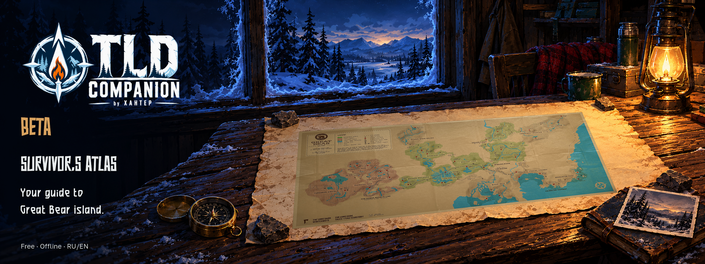
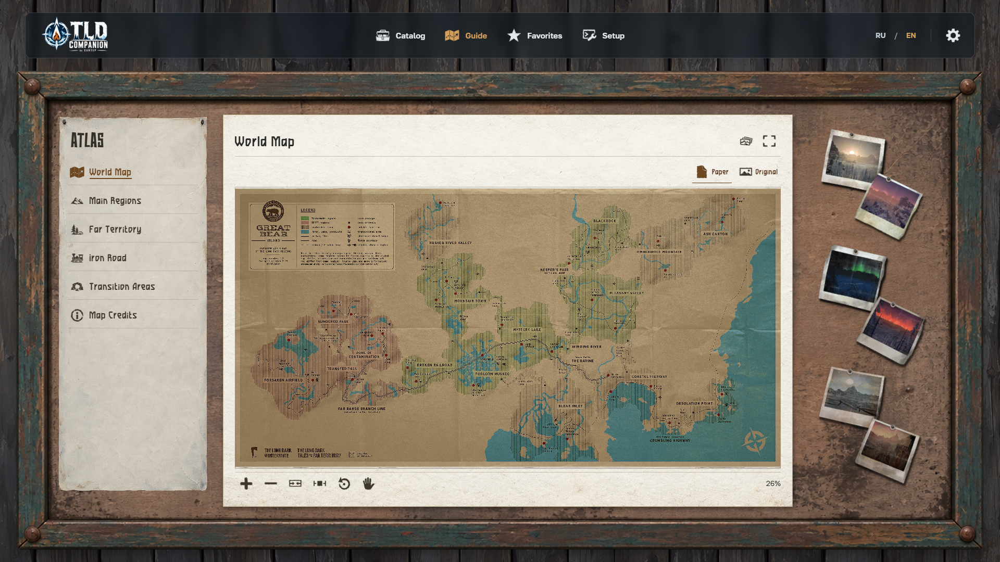
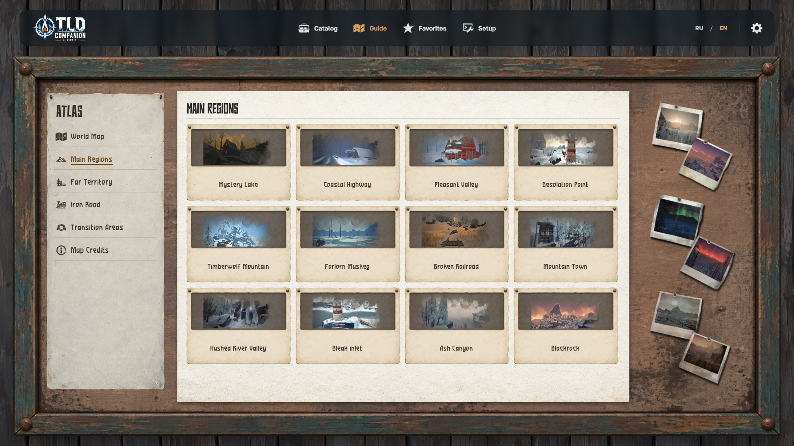
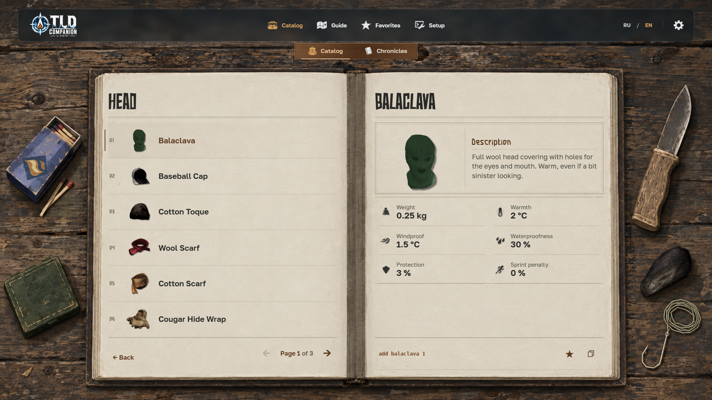
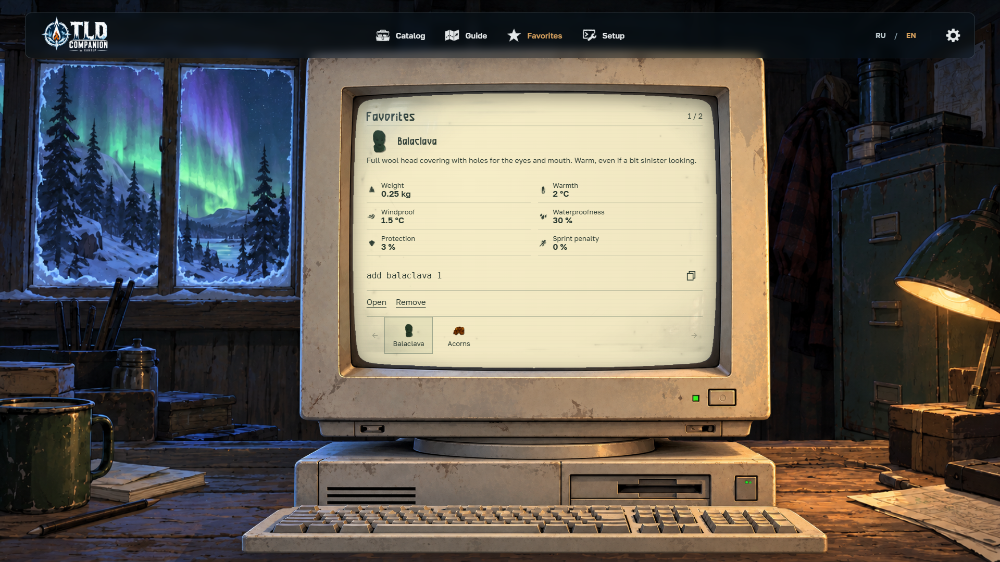
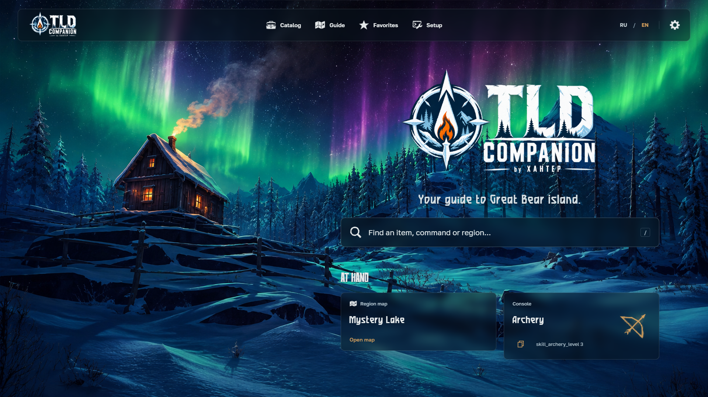

[Русский](README.md) · [**English**](README_EN.md)

# TLD Companion — Beta

**Your guide to Great Bear Island.** A free offline Windows PC companion for The Long Dark: Survival Mode. Items, maps and useful console commands, in Russian and English.

[**Download Beta for Windows PC**](https://github.com/XAHTEP-BNA/TLD-Companion/releases/download/beta/TLD-Companion-Beta.zip) · [**Open online**](https://xahtep-bna.github.io/TLD-Companion/) · [What changed](PATCH_NOTES_EN.md)

## Survivor’s Atlas

Explore the world map, choose a region from the atlas board, zoom into details and open Focus for a larger view. Standard and Interloper variants are available where included. Switch between Paper and Original, then return to your last map from Home.

## Items, commands and Favorites

- **Catalog:** 523 items with original artwork, descriptions and applicable stats in a survivor’s journal.
- **RU/EN search:** find an item by either language and open its entry.
- **Console:** 59 command entries with parameters for available actions and a command preview to copy. Installation instructions have their own navigation entry.
- **Favorites:** keep useful items and commands on the Aurora Terminal.
- **Home:** independent histories for viewed items/commands and maps.

## Get started

1. [Download the Beta ZIP](https://github.com/XAHTEP-BNA/TLD-Companion/releases/download/beta/TLD-Companion-Beta.zip).
2. Extract the entire archive into its own folder.
3. Open **index.html** in **Chrome or Edge**. No internet connection is required.

Or use the [online app](https://xahtep-bna.github.io/TLD-Companion/). Favorites and history are stored in the current browser; different browsers and launch addresses do not automatically share them.

## Before you play

Companion does not modify the game or run commands for you. Install the console separately. Some commands are unavailable, and Iron Road maps are not included. There are 23 map cards including the world map, representing 42 unique source sheets; some cards open a shared sheet. Full 2.58 coverage is not claimed. This is a Beta; report problems through [Issues](https://github.com/XAHTEP-BNA/TLD-Companion/issues).

## Credits

Companion by **XAHTEP**. Maps by **[HokuOwl](https://steamcommunity.com/sharedfiles/filedetails/?id=3255435617)** and **[Krueger](https://steamcommunity.com/sharedfiles/filedetails/?id=2899955301)**. Original credits remain on the maps; links are also available in the offline atlas. The Long Dark and game materials belong to **Hinterland Studio**. This is an unofficial fan project, not affiliated with Hinterland. Font and library notices are included in the ZIP’s `licenses/` folder.

[Current release and checksums](https://github.com/XAHTEP-BNA/TLD-Companion/releases/tag/beta) · [Russian patch notes](PATCH_NOTES_RU.md)
