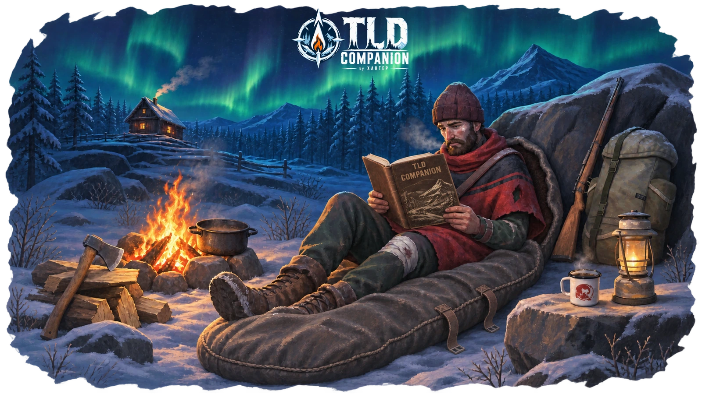
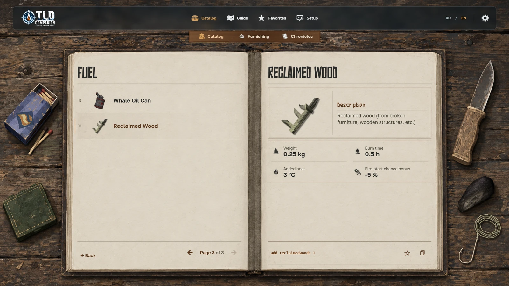

# TLD Companion by XAHTEP

**A free Russian/English reference companion for The Long Dark Survival Mode. Version 1.0.0.**

Find an item, check its stats, study a map or prepare a console command. Browse the catalog as an open journal, explore maps in the atlas and keep useful entries in Favorites. Companion runs in a browser and works offline after downloading.

[Open the web app](https://xahtep-bna.github.io/TLD-Companion/) · [Download from the latest release](https://github.com/XAHTEP-BNA/TLD-Companion/releases/latest/download/TLD-Companion.zip) · [Русский](README.md)

## Start with search

Search from Home using Russian or English names, known aliases or an exact command. Open a matching entry or copy its available command. Two independent “At hand” panels take you back to recently opened maps and entries; collapse either list when you do not need it.

## Items — from index to details

The catalog contains 527 item records across seven categories and 41 subcategories. Choose a section, turn through the index and open an item. Neighboring entries stay on the left page while details appear on the right. Related variants have a selector inside their shared card.

Cards show original artwork, descriptions and confirmed stats. Additional pages provide available usage information and relationships. Notes and wax cylinder transcripts use paginated reading pages. A command is shown separately and can be copied where its exact form is confirmed.

The Whale Oil Can, McLeod’s Portable Heater and Train Brake Pad include their descriptions and artwork. Unconfirmed stats are omitted. An entry does not guarantee that an item can be obtained in every save, region or DLC configuration.

## Furnishing — find things for your shelter

849 cards represent 862 objects, including furniture, household items, lighting and equipment. Ten categories help you browse; 13 families group related variants. Recipes for 44 craftable objects show materials, quantities, tools and crafting time.

Click an underlined recipe material to open its existing Catalog card. Back returns to the same recipe. A material without a reliable match remains plain text.

Spawning furnishing objects requires a compatible SafehouseCustomizationPlus installation. See Setup for installation steps and limitations.

## Console — prepare a command without assembling it by hand

59 entries cover skills, animals, character, afflictions, world and map commands. Choose an action, complete its fields and review the final command before copying. Single-action entries skip the unnecessary selector. Missing or invalid input prevents Copy; unconfirmed actions remain unavailable.

Companion does not execute game commands or install mods. A compatible Developer Console is required. Open Setup in the main navigation for instructions and links. Mod compatibility depends on the game version; not every command and effect has been tested in the running game.

## Guide — examine maps in detail

Open the world map, select a region or explore a transition zone. Pan and zoom, fit a map to the workspace, view its original size or enter focused viewing mode. Some regions offer separate regular and Interloper maps.

The atlas has 23 entries: one world map, 12 main regions, four Far Territory regions and six transition zones. Keeper’s Pass North and South have separate cards that open the same original map sheet. Iron Road maps have not yet been added; unrelated maps are not used as substitutes.

## Favorites — keep useful entries close

Save items, commands and furnishing objects using the star on their cards. Switch between saved entries, open the full card or use an available command directly from Favorites. Saved commands retain their selected action and entered values.

## Setup and offline use

1. Open the [latest release](https://github.com/XAHTEP-BNA/TLD-Companion/releases/latest/download/TLD-Companion.zip) and download `TLD-Companion.zip`.
2. Extract the entire archive to a permanent folder.
3. Open `TLD-Companion/index.html` in Google Chrome or Microsoft Edge.

No server, Node.js or Companion installation is required. Images, maps and fonts are included. External links require internet access and open when you choose them. Companion targets Windows PC, with 1920×1080 as the reference size and 1366×768 also tested. Text is physically smaller in a small window.

Switch languages with RU / EN. Settings, Favorites and history are stored locally in your browser. To retain web data during an update, use the same browser, profile and address. Data does not sync between browsers or transfer automatically between the website and an offline copy. Keep the same folder path for offline updates: `file://` storage behavior depends on the browser. Clearing site data or using private browsing can remove saved data.

## Feedback and credits

Found a problem? [Open an Issue](https://github.com/XAHTEP-BNA/TLD-Companion/issues) with the Companion version, language, browser, window size and steps to reproduce it. For a data issue, include the item or command name.

Created by **XAHTEP**. TLD Companion is an unofficial fan reference, not affiliated with or endorsed by Hinterland Studio. The Long Dark and its original artwork and text belong to their respective rights holders.

Maps by **HokuOwl** ([Steam](https://steamcommunity.com/profiles/76561198212232496), [guide](https://steamcommunity.com/sharedfiles/filedetails/?id=3255435617)) and **Krueger** ([Steam](https://steamcommunity.com/profiles/76561198054890338), [guide](https://steamcommunity.com/sharedfiles/filedetails/?id=2899955301)). Thanks to Elektronixx for the credits source. A separate in-app credits page preserves these links.

Thanks to the authors of Developer Console and SafehouseCustomizationPlus. Companion uses React, Golos Text, NeverSmile, Nozhik and DejaVu. Attribution and license notices are included in the distribution’s `licenses` folder. Listing these materials does not grant rights to them.

## Complete recipe material navigation

All 134 links across 44 furnishing recipes now open existing item entries, including Reclaimed Wood. Return navigation preserves the originating recipe.

