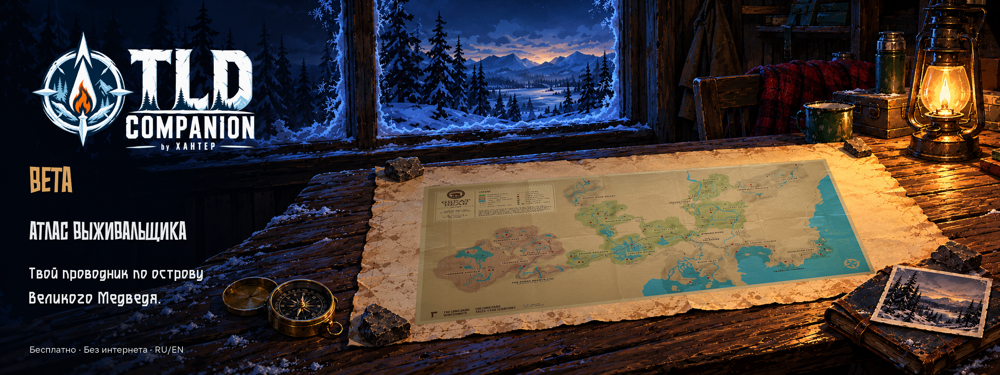

# TLD Companion — Beta

**Атлас выживальщика — твой проводник по острову Великого Медведя.**

[Открыть онлайн](https://xahtep-bna.github.io/TLD-Companion/) · [Скачать ZIP](https://github.com/XAHTEP-BNA/TLD-Companion/releases/download/beta/TLD-Companion-Beta.zip) · [English](https://github.com/XAHTEP-BNA/TLD-Companion/blob/main/README_EN.md)

## В этом обновлении / In this update

- Все шесть фотокарточек видны в обычном окне; превью регионов помещаются в рамки.
- Галерея и карта используют общий бумажный лист; улучшены увеличение, перемещение и возврат из развёрнутого просмотра.
- В Избранном характеристики и действия занимают постоянные места.

All six photos are visible in normal windows. Region previews fit their frames; the gallery and map share one paper workspace. Map zoom, bounded panning and Focus return have been improved. Favorites keeps stats and actions in fixed positions.

[Полные изменения RU](https://github.com/XAHTEP-BNA/TLD-Companion/blob/main/PATCH_NOTES_RU.md) · [Full changes EN](https://github.com/XAHTEP-BNA/TLD-Companion/blob/main/PATCH_NOTES_EN.md)

## Запуск / Launch

Полностью распакуйте ZIP и откройте **index.html** в Chrome или Edge на Windows PC. Интернет не нужен. / Extract the entire ZIP and open **index.html** in Chrome or Edge on Windows PC. Works offline.

Каталог: 523 предмета. Путеводитель: 23 карточки, включая карту мира; 44 файла, 42 уникальных листа. Консоль: 59 разделов команд. Это улучшение предыдущей Beta, а не новое добавление Путеводителя или прежних предметов.

Карты Железной дороги не включены; некоторые команды недоступны. Полное покрытие 2.58 не заявляется. Избранное и история хранятся в текущем браузере. / Iron Road maps are not included; some commands are unavailable. Full 2.58 coverage is not claimed. Favorites and history stay in the current browser.

Карты / Maps: HokuOwl, Krueger. Неофициальный фанатский проект XAHTEP. The Long Dark принадлежит / belongs to Hinterland Studio.
